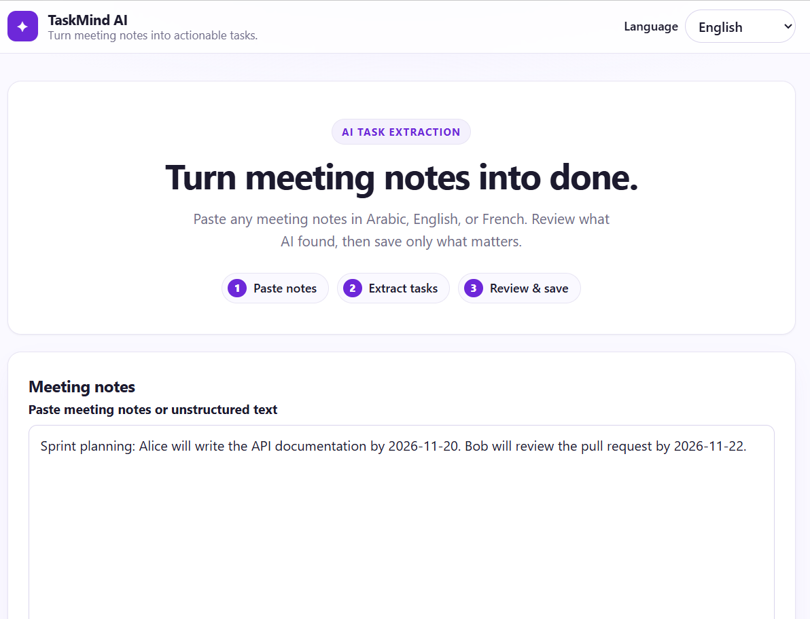
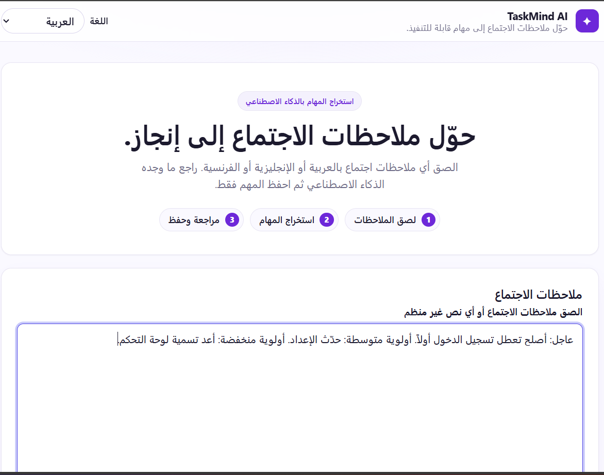
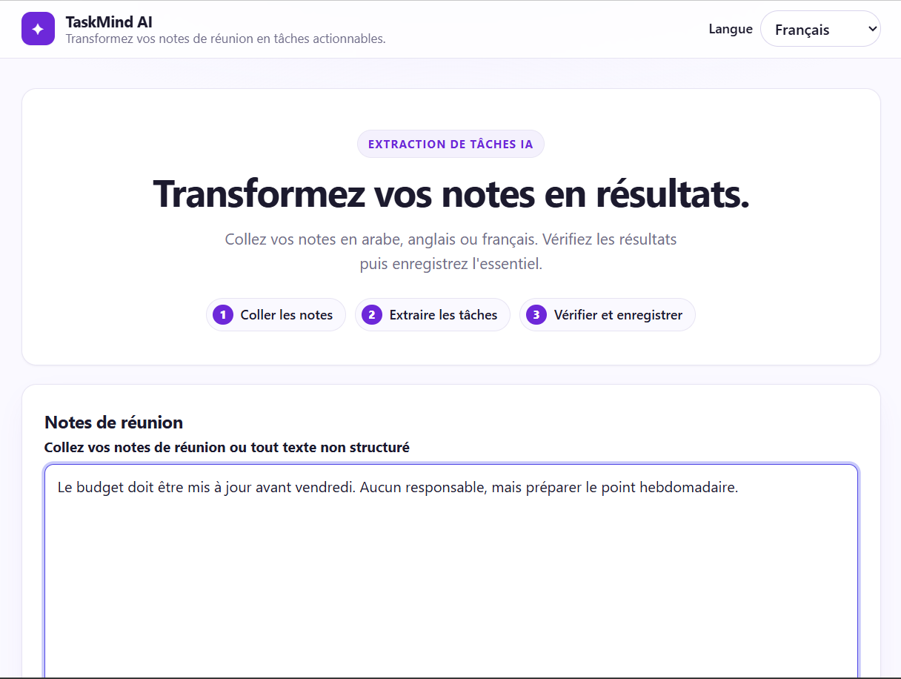
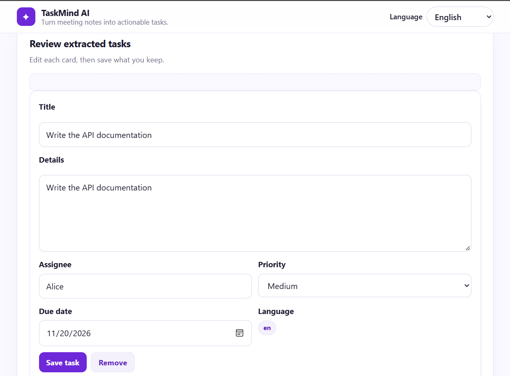
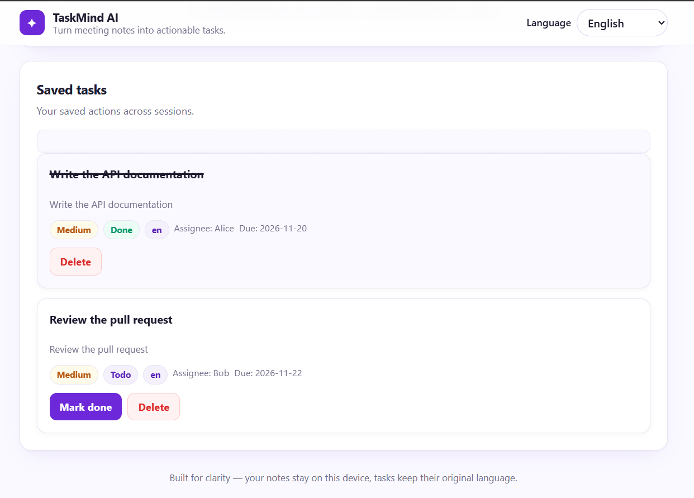

# TaskMind AI

Turn messy meeting notes into clear, actionable tasks. Paste notes in Arabic, English, or French — review what AI found — then save only what matters.

## Problem

Meeting notes mix discussion, decisions, and real actions. People lose track of what was actually agreed, who owns it, and by when. TaskMind AI turns that unstructured text into structured tasks with owner, due date, and priority, while keeping content in its original language.

## Screenshots

### English



### Arabic (RTL)



### French



### Extraction review



### Saved tasks



## Features

- Extract up to 10 tasks per note via Gemini structured JSON
- Edit drafts, remove unwanted items, save explicitly (never auto-saved)
- Full task CRUD: list (newest first), retrieve, patch, delete with confirm
- Task fields: `title`, `details`, `assignee`, `priority` (`low|medium|high`), `due_date` (ISO), `status` (`todo|done`), `language` (`ar|en|fr|unknown`)
- Trilingual UI (en/ar/fr) with RTL for Arabic, LTR for English/French; choice persisted via `localStorage`; extraction stays independent of UI language (task content never translated)
- Validation, 10-task guardrail, sanitized error handling (no keys/notes in responses)
- Deterministic offline evaluation suite (`evaluation/`)

## Supported languages

| Notes / tasks | UI (RTL/LTR) |
|---|---|
| Arabic (`ar`) | Arabic — `dir="rtl"` |
| English (`en`) | English — `dir="ltr"` |
| French (`fr`) | French — `dir="ltr"` |

Language chooser is in the header; preference survives reload.

## Technology stack

| Layer | Choice |
|---|---|
| Language | Python 3.11+ |
| API | FastAPI (Uvicorn server, Pydantic v2) |
| ORM/DB | SQLModel + SQLite (`taskmind.db`) |
| AI | Google Gemini API via `google-genai` (structured JSON) |
| Frontend | Vanilla HTML/CSS/JavaScript (no framework) |
| Tests | Pytest |

## How it works

1. Paste notes → `POST /api/extract` → Gemini returns structured drafts (validated, ≤10).
2. Edit drafts in cards (title/details/assignee/priority/due date) → remove unwanted → save each via `POST /api/tasks` (`priority` defaults to `medium` when null, `status` to `todo`, original language preserved).
3. Manage saved tasks: `GET /api/tasks` list, `PATCH` mark done/edit, `DELETE` with confirm.

## Architecture overview

Single FastAPI process serves the SPA + API; SQLite stores saved tasks only. Gemini extraction (`app/services/ai_service.py`) is stateless and write-free. Full diagram: [docs/architecture.md](docs/architecture.md).

## Project structure

```
app/
  main.py            # FastAPI app, lifespan, health, static
  db.py              # SQLite engine/session
  models.py          # Task + API schemas
  routers/
    extract.py       # POST /api/extract
    tasks.py         # task CRUD
  services/
    ai_service.py    # Gemini structured extraction
  static/            # index.html, styles.css, app.js
docs/
  architecture.md
  evaluation.md
  screenshots/       # manual capture list
evaluation/          # offline metrics + runner + dataset.json (24 examples)
tests/               # pytest suite
.env.example         # placeholder template (no secrets)
requirements.txt
```

## Setup (Windows)

```powershell
cd D:\taskmind-ai
python -m venv .venv
.\.venv\Scripts\Activate.ps1
python -m pip install -r requirements.txt
Copy-Item .env.example .env
# Edit .env and set GEMINI_API_KEY (and optionally GEMINI_MODEL)
.\.venv\Scripts\python.exe -m uvicorn app.main:app --host 127.0.0.1 --port 8000 --env-file .env
```

## Setup (general Python)

```bash
python3 -m venv .venv
source .venv/bin/activate
pip install -r requirements.txt
cp .env.example .env   # then set GEMINI_API_KEY
uvicorn app.main:app --host 127.0.0.1 --port 8000 --env-file .env
```

## Environment variables

```ini
GEMINI_API_KEY=your-gemini-api-key-here
GEMINI_MODEL=gemini-3.5-flash-lite
```

- `GEMINI_API_KEY`: server-only Gemini key (never exposed to browser).
- `GEMINI_MODEL`: overridable (default `gemini-3.5-flash-lite`).
- `DATABASE_URL`: optional override (default `sqlite:///./taskmind.db`).

Without a key, `POST /api/extract` returns `503 AI service is not configured.`; CRUD still works.

## Run application

```powershell
.\.venv\Scripts\python.exe -m uvicorn app.main:app --host 127.0.0.1 --port 8000 --env-file .env
```

Open http://127.0.0.1:8000/ (docs at `/docs`, health at `/health`).

## Run tests

```powershell
.\.venv\Scripts\python.exe -m pytest -q
.\.venv\Scripts\python.exe -m evaluation.runner
```

All tests use mocked AI (no live calls).

## API usage

Base: `http://127.0.0.1:8000`

| Method | Endpoint | Notes |
|---|---|---|
| `POST` | `/api/extract` | `{text}` (10–8000 chars) → `{tasks:[{title,details,assignee,priority,due_date,language}]}`; never persists |
| `POST` | `/api/tasks` | create from draft → `201 TaskRead` |
| `GET` | `/api/tasks` | newest-first list |
| `GET` | `/api/tasks/{id}` | one task or `404` |
| `PATCH` | `/api/tasks/{id}` | partial update; explicit `null` clears only `assignee`/`due_date` |
| `DELETE` | `/api/tasks/{id}` | `204` or `404` |
| `GET` | `/health` | `{"status":"ok"}` |

```bash
curl -X POST http://127.0.0.1:8000/api/extract -H "Content-Type: application/json" ^
  -d "{\"text\":\"Sara will write the report by 2026-11-20.\"}"

curl -X POST http://127.0.0.1:8000/api/tasks -H "Content-Type: application/json" ^
  -d "{\"title\":\"Write report\",\"details\":\"by 2026-11-20\",\"assignee\":\"Sara\",\"priority\":\"high\",\"due_date\":\"2026-11-20\",\"language\":\"en\"}"
```

Errors: `422` validation, `503` AI not configured, `502` AI/provider failure (sanitized details), `404` missing task.

## Security considerations

- Keys only via `.env` (gitignored); `.env.example` holds placeholders. Never commit `.env`/`taskmind.db`/caches.
- Frontend renders via `textContent` (no `innerHTML`); no keys in JS/HTML.
- API errors never echo keys/notes/stack traces; diagnostic logs record only `exception_type/code/gemini_status/category/model`.
- Notes treated as untrusted data; prompt-injection guardrails in the system prompt.

## Limitations & future work

- Small offline dataset (24 examples) — fixture metrics measure harness alignment, not live model quality.
- Single SQLite file (no auth/multi-user, no pagination/migrations).
- No file upload, no background jobs, no concurrent-edit handling.
- Ideas: live evaluation sampling, pagination, export/share, auth.

## Author

Maintainer: `https://github.com/fadwamohamad/taskmind-ai` (placeholder — update after first publish).
